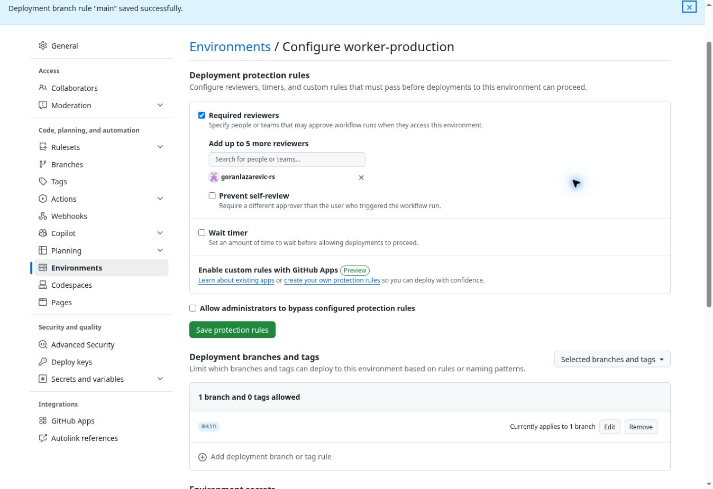

# Worker production approval

## Release procedure

1. Review and merge the release PR only with Goran's explicit approval. A PR or
   push to `main` runs validation and cannot start the Worker deployment job.
2. After merge, copy the full 40-character SHA of the current `main` commit.
3. In Actions → Adriatic Trade Release Gate → Run workflow, select `main`, set
   `deploy_production` to true and paste that SHA into `approved_sha`.
   Leave the checkbox false for validation only (the default).
4. Validation, including all existing runtime/browser/security checks, runs first.
   The deployment then waits for a separate `worker-production` environment review.
5. Goran (`goranlazarevic-rs`) reviews the exact commit and test results and uses
   Review deployments to approve or reject. Automation must never approve on his
   behalf without his express authorization for that exact release.
6. The job checks the approved SHA against the run SHA, checked-out HEAD and current
   remote `main` after approval and again immediately before upload. If `main` has
   advanced, start a new run for the new commit and obtain a new approval.
7. Existing Cloudflare configuration, Cron, version checks and production health
   verification remain in place. Do not rerun a historic pre-gate deployment.

## Settings inspected/configured on 25 October 2026

The repository is owned by a personal account. No classic branch-protection rules
were listed. Active ruleset **Protect main production** (ID 24417970) targets the
default branch `main`, has an empty bypass list, requires a PR and the GitHub
Actions `validate` check, blocks force pushes and restricts deletions. Required
PR approvals: **0**. Requiring branches to be up to date: **off**. These existing
branch rules were inspected and preserved; a PR merge is not production approval.

Previously the only environment was `github-pages`. A separate environment
**worker-production** (ID 25296972254) is now configured with:

- Required reviewer: `goranlazarevic-rs` only.
- Administrator bypass of deployment protection: disabled.
- Selected deployment branches: exact branch `main`; no tags allowed.
- Prevent self-review: off, allowing Goran to initiate a run and separately
  approve it himself. Enabling this would prevent the named sole approver from
  approving his own requested release. Approval is still required each time.

Settings: https://github.com/goranlazarevic-rs/adriatic-trade/settings/environments/25296972254/edit

The workflow explicitly references this environment. Creating a named environment
in YAML alone does not configure required reviewers. Keep the environment's
protection rules in place.

The existing Cloudflare secrets remain repository secrets; their values were not
read, changed or copied. The new validation job never references these secrets;
the deployment job cannot start before environment approval. Migrating credentials
to environment-only secrets would additionally protect against old workflow reruns
and other workflows accessing repository secrets; that migration requires the
credential holder to re-enter the existing values or rotate them. Direct Cloudflare
dashboard/CLI publishing is outside this GitHub workflow's control.

## Verification without a production deployment

- `actionlint` v1.7.7: passed for the edited workflow.
- `tests/release-gate.mjs`: passed 36 event/ref/opt-in combinations. `push`, PR,
  non-main refs, tags and validation-only dispatch cannot select the deploy job.
- The real shell guard passed 13 isolated cases with a fake local `git`: only the
  approved current main SHA succeeds. Wrong/missing/malformed SHA, different checkout,
  advanced main and failed/empty remote lookup all fail closed.
- Policy tests parse the actual YAML, require identical PR/push path lists including
  `checkout.html` and the guard script, successful validation dependency, immutable
  checkout, protected environment and revision checks before secret use/upload.
- Existing admin operations, 34 local-delivery tests, 16 notification-outbox tests
  and 6 checkout/security tests: passed locally.
- Actual local workerd/D1/R2 regression: passed, including transactional rollback,
  receipt persistence and eight simultaneous checkout requests producing exactly
  five acceptances and three rate-limit responses. Outbound services are simulated.
- Shell/JavaScript syntax and `git diff --check`: passed.
- Local Chromium download failed (empty/invalid archive from browser download CDN).
  The unchanged pinned Chromium integration checks remain mandatory in PR CI.
  Check that run before approving merge; local checks do not substitute for it.

No Cloudflare deployment command, production order, live email or production health
check was executed during this change. A live production-environment approval run
was deliberately not started. PR CI must show `deploy` as skipped.

The old automatic deployment behavior on `main` remains until this PR is approved
and merged. The new environment exists, but the old workflow does not reference it.
